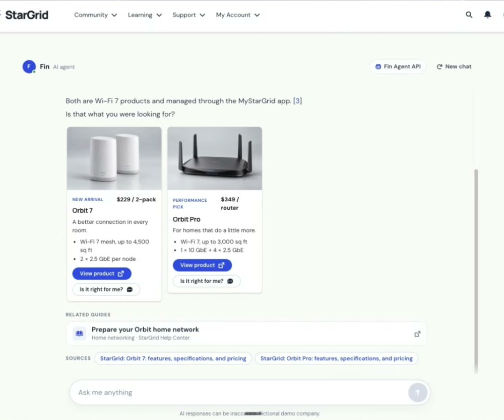
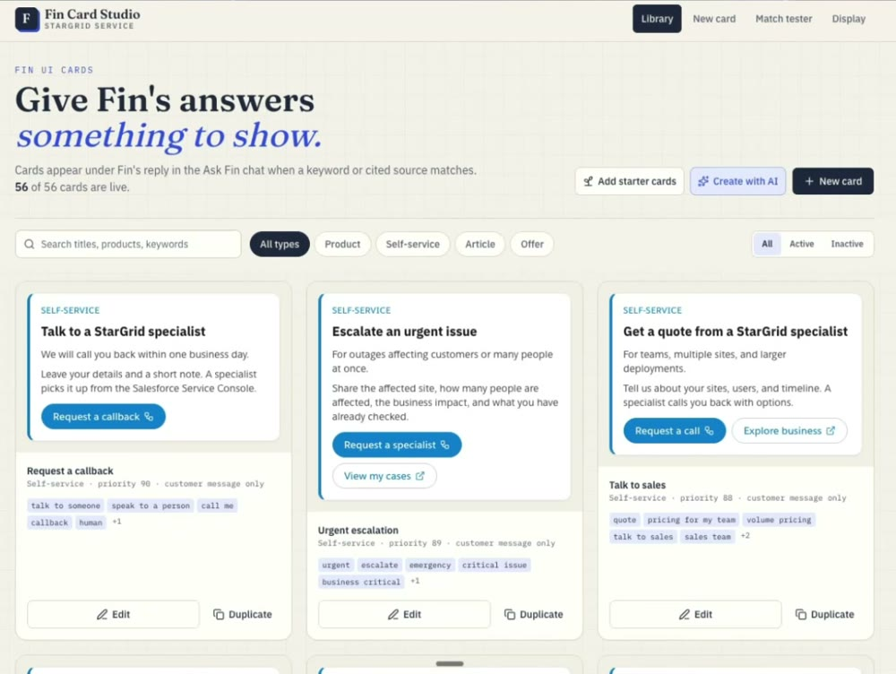
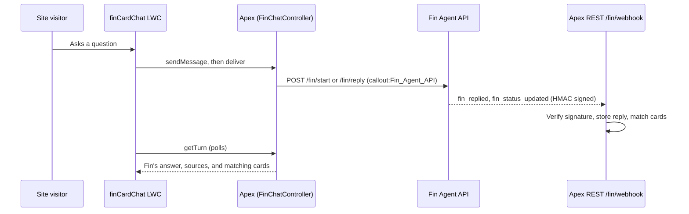

# Fin Card Chat for Salesforce Experience Cloud

Put Fin, the Intercom AI agent, on a Salesforce Experience Cloud page, and show rich product, offer, guide, and self-service cards under Fin's answers. Admins build and test those cards in **Fin Card Studio**, a React app that runs inside Salesforce.

> **Demo software. Not an official Salesforce or Intercom product.** Built for demonstrations and proofs of concept. Review it, test it in a sandbox, and own it before using it anywhere near production.



*Shown with the optional StarGrid sample data (a fictional company).*

## What you get

| Piece | What it is |
| --- | --- |
| **Fin Card Chat** (`finCardChat` LWC) | An inline chat for Experience Cloud pages (also Lightning App and Home pages). Talks to the Fin Agent API through Apex, and shows matching cards under each answer. Works for guest visitors. |
| **Fin Search Bar** (`finSearchBar` LWC) | Optional "Ask Fin" bar for a site home page that hands the question to the chat page. |
| **Fin Card Studio** (UI Bundle app) | Build, preview, and AI-draft cards; test which cards match a question; set card size and count. |
| Apex and data model | `Fin_UI_Card__c` (cards), `Fin_Chat_Conversation__c` and `Fin_Chat_Message__c` (transcripts), `Fin_Agent_Settings__c` (settings), webhook receiver, card matcher, AI card generator. |
| Named and external credential | `Fin_Agent_API`. **You add your own Fin API key in Setup; no key ships in this repo.** |
| `Fin_Request_Callback` flow | Example self-service flow a card can launch (creates a callback Case). |
| `sample-data/stargrid` (optional) | About 55 StarGrid starter cards and the CSP trusted site for their images. |



## How it works



Fin answers asynchronously: Salesforce sends the question, Fin posts its answer to a webhook on your Experience site, and the component polls until the answer arrives. Cards are matched by keywords in the visitor's message or Fin's reply, and by the URLs Fin cites.

## Quick start

You need a Salesforce org with Experience Cloud, the Salesforce CLI, Node.js 22 or later, and a Fin workspace with the Fin Agent API enabled.

```sh
git clone https://github.com/sfdc-brendan/fin-card-chat.git
cd fin-card-chat
sf org login web --alias my-org            # if you have not authorized the org yet
scripts/setup.sh -o my-org --seed --site "My Site"
```

Then finish the four manual steps (API key, settings, page, webhook) in **[docs/INSTALL.md](docs/INSTALL.md)**. Plan on about 30 minutes end to end.

## Documentation

- [docs/INSTALL.md](docs/INSTALL.md): full installation, step by step
- [docs/CONFIGURE-FIN.md](docs/CONFIGURE-FIN.md): Fin workspace side (API key, webhook, region, content)
- [docs/CARD-STUDIO.md](docs/CARD-STUDIO.md): building cards, matching rules, AI drafts, display settings
- [docs/TROUBLESHOOTING.md](docs/TROUBLESHOOTING.md): symptoms, causes, and fixes
- [sample-data/stargrid/README.md](sample-data/stargrid/README.md): the optional sample data

## Security notes

- The Fin API key lives only on the `FinAgent` principal of the `Fin_Agent_API` external credential. It is never in metadata, Apex, or the browser.
- The webhook secret lives in the `Fin_Agent_Settings__c` org-default record. Every webhook is checked with HMAC-SHA256 before anything is stored.
- Guest visitors only hold a random session token; conversations are looked up by its SHA-256 hash. No Apex method accepts object names, field names, or record IDs from the browser.
- Admins with View Setup can read custom setting values (Protected visibility only applies in managed packages). Limit who has View Setup if that matters in your org.
- Run `scripts/scan-secrets.sh` before you push a fork.

## Development

```sh
npm install && npm run test:lwc       # LWC Jest tests
npm run test:studio                   # Fin Card Studio unit tests
sf apex run test -o my-org -l RunLocalTests -w 20
```

## License

[MIT](LICENSE)
