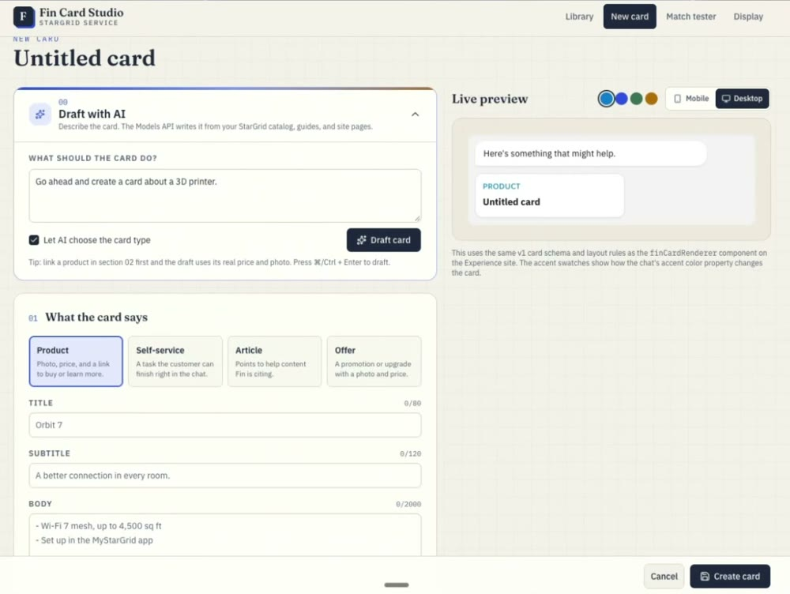

# Fin Card Studio

Fin Card Studio is a React app (a Salesforce UI Bundle) for building the cards that appear under Fin's answers. Open it from **App Launcher, Fin Card Studio**. You need the **Fin Card Studio Admin** permission set.



*Shown with the StarGrid sample data.*

## Pages

| Page | Use it to |
| --- | --- |
| **Library** | Browse, search, filter (by type and active or inactive), edit, and duplicate cards. Load the StarGrid starter set when the sample is deployed. |
| **New card / Edit** | Build a card with a live preview (desktop and mobile, with accent color swatches), or draft it with AI. |
| **Match tester** | Type a visitor message, an optional Fin reply, and optional cited URLs, and see which cards would show and why. |
| **Display** | Set the default card size (standard or compact) and the number of cards per answer for every chat. |

Cards are ordinary `Fin_UI_Card__c` records, so you can also manage them from the **Fin UI Cards** tab, list views, reports, or data loader.

## Card types

| Type | Shows as | Typical actions |
| --- | --- | --- |
| **Product** | Carousel card with image, badge, price, and bullets. Link it to a Product2 record to fill in name, description, price, and image. | Open the product page; send "Is it right for me?" to Fin. |
| **Offer** | Same layout as Product, for plans, bundles, and promotions. | Open the plan page; ask Fin a follow-up. |
| **Article** | Compact "Related guides" link under the answer. | Open the guide. |
| **Self-service** | Action card the visitor can finish in the chat. | Launch a screen flow (for example `Fin_Request_Callback`); open a portal page. |

## Actions

Each card has up to two buttons, primary and secondary:

- **Open URL** opens a link in a new tab.
- **Send message to Fin** sends the button's value as the visitor's next question.
- **Launch flow** runs a screen flow inline in the card. The flow must be active, and the guest user (or site member) needs access to it. Add the flow to `Fin_Card_Chat_Guest` if you build your own; `Fin_Request_Callback` is already included.

## How cards match

After each Fin answer, the matcher scores every **active** card:

1. **Trigger keywords.** One phrase per line (commas and semicolons also separate phrases). A phrase matches whole words, case-insensitively, ignoring punctuation, and also matches its plural with a trailing "s". Each matching phrase adds 1 point.
2. **Match on** decides where keywords are searched: the **visitor message**, **Fin's reply**, or **both**. Use "visitor message" for articles and self-service cards so Fin's wording cannot trigger them by accident.
3. **Source URL contains.** If any URL Fin cited contains this text, the card gets 2 points. This is the most reliable trigger for guide cards: Fin cites the page, the card follows.
4. Cards with at least 1 point are sorted by **Priority** (1 to 100, higher first), then by points, then by name, and the top **N** are shown (Display page or component setting, 1 to 6).
5. A card already shown in the conversation is not repeated.

**Priority guide:** self-service 75 to 90, urgent troubleshooting 50 to 65, offers 54 to 62, products about 50, informational guides 35 to 48.

Use **Match tester** whenever you add keywords; it lists the reason for every hit (for example `Visitor said "dead zone"` or `Fin cited https://...`).

Active cards are cached in the Platform Cache partition `local.FinCards` if you create one, and the cache clears automatically whenever a card changes.

## Draft with AI

**Create with AI** (Library) or **Draft with AI** (editor) asks the Models API to write a card from a short brief, for example "a card for gamers asking about latency, linked to our router". You can also refine an existing card with an instruction such as "make the title shorter".

It needs:

- Einstein generative AI turned on in Setup.
- The model in **Fin Agent Settings, Card Model** to be available (blank uses `sfdc_ai__DefaultBedrockAnthropicClaude46Sonnet`).

The draft is grounded in your active products (name, family, description, standard price, and `Product2.Image_URL__c` if your org has that field), your highest-priority existing cards as style examples, and, with the StarGrid sample, its catalog pages.

Guardrails applied in Apex, not left to the model:

- **Links and images must stay on the Site Base URL** set in Fin Agent Settings. Anything else is dropped. With no Site Base URL, AI drafts have no links.
- **Flows** must be in the allowed list (`Fin_Request_Callback`). To allow another flow, add it to `FinCardGenerator.FLOWS`.
- **Products** must exist and be active. **Prices** only appear when the product has a standard price.
- Lengths, keyword counts, and priorities are clamped.

Nothing is saved until you review the draft and choose **Create card**.

## Images

Card images load in the visitor's browser, so each image host must be a **CSP Trusted Site** with img-src enabled (Setup, CSP Trusted Sites). The editor warns you when a card's image host is not trusted. Use HTTPS images about 640 px wide.

## Developing the studio

```sh
cd force-app/main/default/uiBundles/FinCardStudio
npm ci
npm run dev       # local Vite dev server
npm test          # unit tests (Vitest)
npm run build     # writes dist/, which is what deploys
```

GraphQL operation types are checked in (`src/api/graphql-operations-types.ts`). After changing a query, run `npm run graphql:schema` against your org to fetch the schema, then rebuild; codegen runs automatically when the schema file exists.
